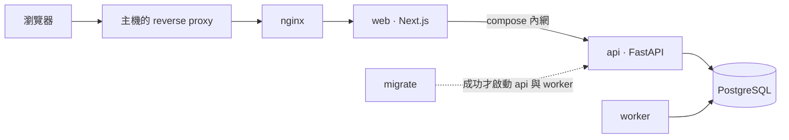

# Project Foundation

FastAPI + Next.js 的全端系統骨架：登入、使用者與角色權限、背景任務與排程、中英雙語都已經接好，
新功能以「模組」為單位加進來。設計的優先順序是**上線後好維護、出問題好查**。

## 快速開始

需要 Docker（Compose v2.24 以上）、`make`、`python3`（3.9 以上）、`uv`（0.13 以上）與 Node（版本見
[`apps/web/.nvmrc`](apps/web/.nvmrc)）。

```bash
make init dev   # 產生 .env（金鑰自動產生）、安裝相依
make start      # 啟動整套服務，第一次會建置映像檔
make db superuser   # 建立第一個超級管理者
```

打開 `http://localhost:3000`。其餘指令見 `make help`。

## 包含什麼

| | |
|---|---|
| 後端 | Python 3.15、FastAPI、SQLAlchemy 2.1（async）、Alembic、PostgreSQL 18 |
| 前端 | Node 26、Next.js 16、React 19、TypeScript、CSS Modules |
| 功能 | 登入與登入狀態撤銷、使用者管理、角色權限（後台可分權）、個人設定、登入限流 |
| 背景任務 | worker 容器、PostgreSQL 佇列、cron 排程、失敗重試 |
| 排查 | 結構化 log、貫穿各層的 request id、錯誤代碼、AUDIT 資料表、`make doctor` |
| 契約 | 後端產生 OpenAPI → 前端型別；端點、權限、語系寫錯都是編譯錯誤 |
| 維運 | Docker Compose、依 GitHub environment 部署、備份與還原 |

## 架構

```text
app（組裝層） → modules（一個功能一個模組） → shared（平台能力）
```



瀏覽器只碰得到 web；資料存取一律經過 Next 的伺服器端。依賴方向與模組邊界由工具檢查，違反就是 CI 紅燈。

## 文件

| | |
|---|---|
| [`AGENTS.md`](AGENTS.md) | 給 AI agent 的規則（Claude 與 Codex 共用） |
| [`docs/foundation/architecture.md`](docs/foundation/architecture.md) | 分層、模組介面、前後台、契約、每個請求經過什麼 |
| [`docs/foundation/development.md`](docs/foundation/development.md) | 開發環境、指令、程式碼風格 |
| [`docs/foundation/testing.md`](docs/foundation/testing.md) | 測試策略、驗收條件、改程式不改測試 |
| [`docs/foundation/workflow.md`](docs/foundation/workflow.md) | 開發流程、提交與 CI、相依升級 |
| [`docs/foundation/operations.md`](docs/foundation/operations.md) | 部署、發版、備份與還原、出問題怎麼查 |
| [`docs/foundation/new-module.md`](docs/foundation/new-module.md) | 新增一個功能模組 |
| [`docs/foundation/permissions.md`](docs/foundation/permissions.md) | 新增權限、怎麼切權限 |
| [`docs/foundation/migrations.md`](docs/foundation/migrations.md) | 改資料表、初始資料 |
| [`docs/foundation/jobs.md`](docs/foundation/jobs.md) | 背景任務與排程 |
| [`docs/foundation/hooks-and-skills.md`](docs/foundation/hooks-and-skills.md) | agent 的 hooks 與 skills |
| [`docs/foundation/decisions.md`](docs/foundation/decisions.md) | 刻意不採用主流做法的地方與理由 |
| [`docs/project/`](docs/project/README.md) | 用這份骨架建立的專案自己的文件與決定 |

## 用這份骨架開新專案

1. 複製這份目錄（或在 GitHub 用 **Use this template**），`make init dev`。
2. 記下是從 foundation 的哪個 commit 開始的，之後才能同步它的更新
   （[說明](docs/foundation/workflow.md#與-foundation-同步)）：

   ```bash
   python3 .agents/skills/sync-foundation/scripts/sync.py init <foundation 的 repo 位址>
   ```

3. 改寫這份 README、[`LICENSE`](LICENSE) 與 `.env.example` 的預設名稱。
4. 照 [`docs/foundation/workflow.md`](docs/foundation/workflow.md#github-設定) 設定 GitHub（squash merge、`main` 的 ruleset）。
5. 照 [`docs/foundation/hooks-and-skills.md`](docs/foundation/hooks-and-skills.md#啟用) 啟用要用的 AI agent。少了這一步 hook 不會生效，也不會報錯。
6. 在 `apps/web/app/theme.css` 覆寫設計變數決定外觀。
7. 照 [`docs/foundation/new-module.md`](docs/foundation/new-module.md) 加入第一個模組。
